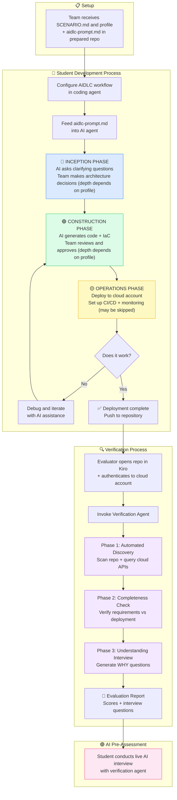
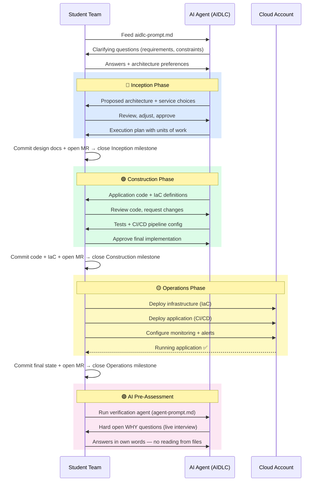
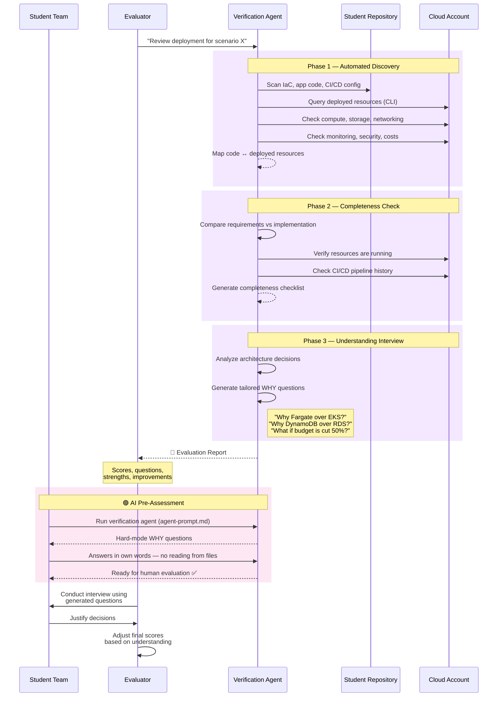
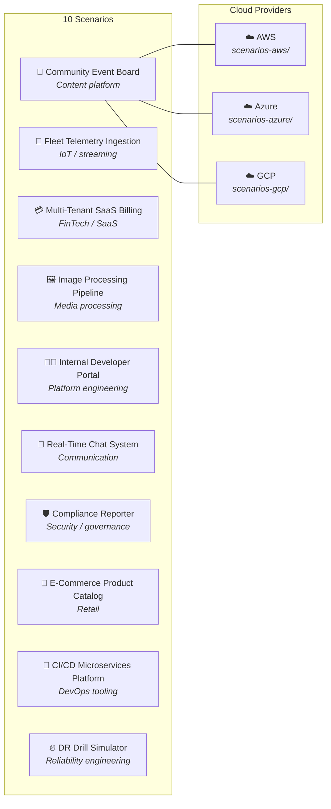
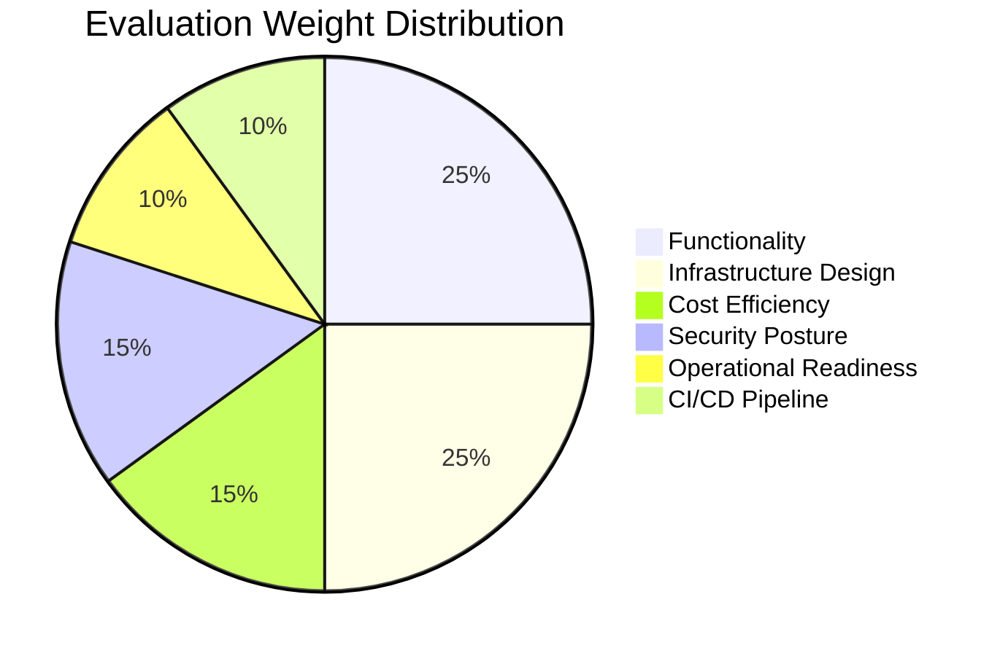

# Project Education for DevOps — AI-Assisted Scenarios

A collection of hands-on scenarios for DevOps teams to build and deploy real applications on cloud infrastructure using AI-driven development (AIDLC methodology). Available for **AWS**, **Azure**, and **GCP**.

## What Is This

This is a practical assessment module for DevOps courses. After completing the core curriculum, student teams receive a scenario — a realistic application with functional requirements and infrastructure expectations — and must design, build, and deploy it on a cloud platform **with AI assistance**.

The key twist: AI helps with implementation, but **students must understand and justify every decision**. A verification agent then examines the deployment and conducts an interview focused on *why*, not *how*.

> 🎯 **DevOps Focus**: This project is about **infrastructure, not application code**. Front-end and back-end components should be replaced with stubs, mocks, or minimal implementations — just enough to validate the infrastructure works. Your time and effort should go into IaC, CI/CD, networking, security, monitoring, and operational decisions.

> 💼 **Interview Preparation**: Think of this as practice for a real technical interview or solution discussion with a customer. You are expected to present architecture options, justify trade-offs, and defend your decisions — the same skills assessed when discussing cloud solutions with stakeholders or during DevOps/Cloud engineer interviews.

## How It Works



## Student Workflow — Step by Step



## Verification Workflow — How Evaluation Works

For final verification, the instructor-specified git action (for example, a branch push, tag, or merge request) triggers a fresh sandbox deployment and the verification agent checks the live result.



## Scenarios Overview

Each scenario is a realistic application that requires teams to make meaningful infrastructure decisions. The same 10 scenarios are available for all three cloud providers, adapted to each platform's native services.



| # | Scenario | Domain | What Students Decide |
|---|----------|--------|---------------------|
| 1 | **Community Event Board** | Content platform | Compute model, data storage, CDN, async email delivery |
| 2 | **Fleet Telemetry Ingestion** | IoT / streaming | Ingestion protocol, stream processing, time-series storage |
| 3 | **Multi-Tenant SaaS Billing API** | FinTech / SaaS | Data isolation strategy, API management, async billing |
| 4 | **Image Processing Pipeline** | Media processing | Object storage, processing compute scaling, queue orchestration |
| 5 | **Internal Developer Portal** | Platform engineering | Container orchestration, search engine, SSO integration |
| 6 | **Real-Time Chat System** | Communication | WebSocket management, pub/sub, message persistence |
| 7 | **Scheduled Compliance Reporter** | Security / governance | Cross-account scanning, scheduled compute, alerting |
| 8 | **E-Commerce Product Catalog** | Retail | Database + search engine, caching strategy, traffic scaling |
| 9 | **CI/CD Platform for Microservices** | DevOps tooling | Pipeline orchestration, artifact management, env isolation |
| 10 | **Disaster Recovery Drill Simulator** | Reliability engineering | Multi-region architecture, backup validation, DNS failover |

## Evaluation Criteria



| Dimension | Weight | What Is Assessed |
|-----------|--------|-----------------|
| **Functionality** | 25% | Does the application work as described in the scenario? |
| **Infrastructure Design** | 25% | Are service choices appropriate and well-justified? |
| **Cost Efficiency** | 15% | Is the deployment cost-conscious for the workload? |
| **Security Posture** | 15% | Least privilege, secrets management, network isolation |
| **Operational Readiness** | 10% | Monitoring, logging, alerting, incident response readiness |
| **CI/CD Pipeline** | 10% | Automated build → test → deploy flow |

The verification agent asks **why, not how**. A well-justified unconventional choice scores higher than an unjustified conventional one.

## Final Demo Presentation

Each team must deliver a **live demo presentation** to a panel of human experts. This is a mandatory part of the evaluation process.

### Requirements

| # | Requirement | Details |
|---|-------------|---------|
| 1 | **Live Demo** | The presentation must include a live demonstration of the deployed, working application — not screenshots or recordings. The system must be running in the cloud and demonstrated in real time. |
| 2 | **Architecture Diagram** | The presentation **must** include a manually created architecture diagram using official cloud provider icons and symbols. Auto-generated diagrams (e.g., from IaC tools) are **not accepted**. |
| 3 | **Time Limit** | Strict **10-minute** maximum. Presentations exceeding the time limit will be stopped. |

### Architecture Diagram Guidelines

The architecture diagram must be created by the team (not auto-generated) and use official brand icons:

- **AWS**: [AWS Architecture Icons](https://aws.amazon.com/architecture/icons/) — reference examples at [AWS Reference Architecture Diagrams](https://aws.amazon.com/architecture/reference-architecture-diagrams/)
- **Azure**: [Azure Architecture Icons](https://learn.microsoft.com/en-us/azure/architecture/icons/)
- **GCP**: [Google Cloud Architecture Icons](https://cloud.google.com/icons)

The diagram should clearly show:
- All major services/resources used and their relationships
- Data flow between components
- Network boundaries (VPCs, subnets, security groups)
- External integrations and user entry points

> ⚠️ **The diagram demonstrates that the team understands the architecture they built — not just that they can deploy code generated by AI.**

### Suggested Demo Structure (10 min)

| Time | Section |
|------|---------|
| 0:00–2:00 | Architecture overview using the diagram |
| 2:00–7:00 | Live demo of the running application |
| 7:00–9:00 | Key decisions and trade-offs |
| 9:00–10:00 | Summary and lessons learned |

## Repository Structure

```
├── README.md                          ← you are here
├── AGENTS.md                          ← canonical guidance for any AI agent
├── CLAUDE.md                          ← pointer to AGENTS.md
├── SETUP.md
├── VERIFICATION.md
├── VERIFICATION-PLAN.md
├── agents-install/
│   └── KIRO.md
├── scenarios-aws/
│   ├── README.md
│   ├── aws-budget-guide.md
│   ├── scenario-01-community-event-board/
│   │   ├── SCENARIO.md
│   │   └── aidlc-prompt.md
│   ├── ... (scenarios 02–10)
│   └── verification-agent/
│       ├── README.md
│       ├── agent-prompt.md
│       └── question-bank.md
├── scenarios-azure/
│   ├── README.md
│   ├── azure-budget-guide.md
│   ├── scenario-01-community-event-board/
│   │   ├── SCENARIO.md
│   │   └── aidlc-prompt.md
│   ├── ... (scenarios 02–10)
│   └── verification-agent/
│       ├── README.md
│       ├── agent-prompt.md
│       └── question-bank.md
└── scenarios-gcp/
    ├── README.md
    ├── gcp-budget-guide.md
    ├── scenario-01-community-event-board/
    │   ├── SCENARIO.md
    │   └── aidlc-prompt.md
    ├── ... (scenarios 02–10)
    └── verification-agent/
        ├── README.md
        ├── agent-prompt.md
        └── question-bank.md
```

## Auto-Deployment

Deployment happens in two phases, both driven by the same `.gitlab-ci.yml` pipeline in your repository.

See [AUTO-DEPLOY.md](AUTO-DEPLOY.md) for the authoritative deployment phases, required variable names, pipeline rules, and common pitfalls.

---

## Getting Started

### For Instructors

1. Choose the cloud provider for your course (AWS, Azure, or GCP)
2. Assign one scenario per team (10 scenarios for 10 teams)
3. Provide students with the scenario folder and AIDLC setup instructions
4. After deployment, use the verification agent to generate evaluation reports
5. Conduct interviews using the agent-generated questions

### For Students

1. Read your `SCENARIO.md` carefully — understand the functional requirements and infrastructure expectations
2. **Set up GitLab project tracking** — create Milestones (Inception / Construction / Operations) and open your Issue Board before writing a single line of code. See [SETUP.md](SETUP.md) Step 6 for the full workflow.
3. **Install the AI-DLC v2 framework and configure it into your repo** ([Getting Started](https://awslabs.github.io/aidlc-workflows/guide/01-getting-started/)) — install the native `aidlc` command, run `aidlc config --harness <your-harness>` and `aidlc doctor`, then confirm `/aidlc --doctor` passes. This is **mandatory**, not optional. See [SETUP.md](SETUP.md) Step 7 for the full procedure and the scenario→profile mapping.
4. Start the AI-DLC **conductor** with the profile your scenario specifies (its `## AI-DLC Profile` section — `poc`/`mvp`, `feature`, or `enterprise`) and point it at `aidlc-prompt.md` (e.g. `/aidlc <profile> Follow ./aidlc-prompt.md`); as the conductor produces the execution plan, split the work into GitLab Issues and assign each to a team member. The conductor records your decisions in the `aidlc/` workspace — that decision trail is what proves ownership at verification.
5. Work through the phases your profile runs (Inception → Construction, plus Operation for `enterprise` scenarios), closing issues and opening MRs as work completes
6. Deploy to your cloud account — your CI/CD pipeline handles this automatically on every commit to `main`; see [AUTO-DEPLOY.md](AUTO-DEPLOY.md) for what the pipeline must include
7. Be ready to explain **why** you made each architectural decision
8. Prepare your architecture diagram (manually, using official cloud icons) and live demo for the final presentation

> ⚠️ **AIDLC framework installation is required.** The verification agent checks for proper AIDLC setup and generated documentation. Projects without AIDLC workflow configured and phase documents produced will be marked incomplete regardless of deployment quality.

> The framework is required because it produces the **decision trail** (`aidlc-state.md`, `audit.md`, design and requirement docs) that the verification agent uses to generate interview questions about *your* decisions. Without it, there is nothing for the interviewer to ask about, and the project cannot demonstrate ownership.

### Repository Deliverables

The following must be included in the team's repository:

| # | Deliverable | Details |
|---|-------------|---------|
| 1 | **`.gitlab-ci.yml`** | GitLab CI pipeline that deploys all infrastructure and application code automatically on commit to `main` — no manual steps, must exit 0 |
| 2 | **AIDLC decision trail** | The `aidlc/` workspace with `aidlc-state.md`, `audit.md`, and all phase artifacts (inception/construction/operations) produced by the AI-DLC conductor — this is the evidence of ownership |
| 3 | **Architecture diagrams** | `.drawio` files with the architecture diagrams used in the presentation |
| 4 | **PowerPoint presentation** | The final demo presentation. Use a clear, professional template appropriate for your audience. |

### Test Data

Real data is not needed. AI generates realistic seed data, simulators, and load generators as part of the development process. This is part of the exercise — defining what data the system needs and how to simulate it is a design decision.

## Prerequisites

- Completed core DevOps course for the target cloud platform
- Cloud account/subscription/project with appropriate permissions
- CLI configured and authenticated (`aws`, `az`, or `gcloud`)
- AI-DLC v2 framework installed (`aidlc` command) and configured into the project — see [SETUP.md](SETUP.md) Step 7 and [Getting Started](https://awslabs.github.io/aidlc-workflows/guide/01-getting-started/)
- Familiarity with at least one IaC tool (Terraform, CloudFormation/CDK, Bicep, or Deployment Manager)

## License

Educational use. See individual cloud provider folders for detailed documentation.
