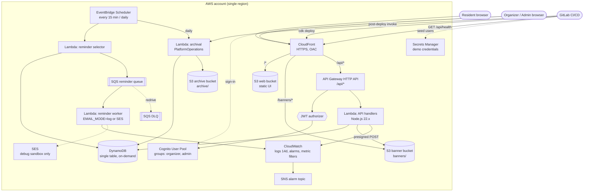

# Architecture — Community Event Board

Serverless AWS architecture, defined in AWS CDK v2 (TypeScript), deployed by one GitLab pipeline into a single region taken from `AWS_DEFAULT_REGION` (default `us-east-1`). All resource names use the `team32-ceb-` prefix and the tag `project=team32-ceb`.

Source of truth: `aidlc/spaces/default/intents/261001-community-event-board/inception/` (requirements-analysis, domain-design, contract-design, delivery-planning).

Draw.io version with AWS icons (two pages: architecture, CI/CD pipeline): [`docs/diagrams/architecture.drawio`](diagrams/architecture.drawio).

## Deployment view

## Request flows

| Flow | Path | Notes |
|---|---|---|
| Browse / detail | Browser → CloudFront → `/api/events[/{id}]` → Lambda → DynamoDB (GSI1–GSI3) | Public, no sign-in; records an EventView (`list` / `detail`). |
| RSVP | `POST /api/events/{id}/rsvps` → one DynamoDB transaction on the same partition (`EVENT#{id}`) | Capacity counter + registration written atomically; overflow becomes `waitlisted`. |
| Cancel | `POST /api/rsvps/cancel` (token in body) | Token digest lookup; confirmed cancel promotes earliest waitlisted entry atomically. |
| Manage events | JWT (Cognito) → API Gateway authorizer → Lambda | Organizer: own events; admin: all events + statistics. |
| Banner upload | API returns presigned POST → browser uploads directly to S3 | S3 enforces 1–5,242,880 bytes and JPEG/PNG/WebP. |
| Reminders | Scheduler (15 min) → selector → SQS → worker → CloudWatch Logs (final) / SES (debug) | Failures go to DLQ; one ReminderAttempt per (event, registration). |
| Archival | Daily schedule or pipeline invoke → archival Lambda → S3 `archive/{eventId}.json` → remove active data | Active data removed only after the S3 write succeeds. |
| Health | `GET {SiteUrl}/api/health` → `200 {"status":"ok"}` | Pipeline exits 0 only after this succeeds. |

## Logical components (domain-design)

| Component | Owns | Unit / issue |
|---|---|---|
| PlatformOperations | Health endpoint, deterministic seed, archival orchestration | C1 (health, seed), C5 (archival) |
| AccessControl | Cognito roles, ownership policy | C3 |
| EventManagement | Event, ArchivedEvent, capacity, banner presigned POST | C3 |
| PublicDiscovery | Public list/detail, records EventView | C3 |
| RSVP | Registration (incl. waitlist state), cancel tokens | C3 |
| Reminders | ReminderAttempt, selector + worker | C5 (code), C6 (scheduler/queue/DLQ) |
| Statistics | EventView, admin aggregates | C5 |
| ResidentExperienceUI, OrganizerAdminManagementUI, SignInUI | UI | C4 |

Dependency rule: EventManagement never calls RSVP; RSVP calls EventManagement for the atomic capacity transition; PlatformOperations calls both for seeding and archival.

## Environments

| Environment | Purpose | Differences |
|---|---|---|
| Debug sandbox (8 h) | Development, real SES proof, 500-user load test, `TEARDOWN=true` cleanup proof | May use `AWS_SESSION_TOKEN`; credentials rotated with `scripts/sandbox-login.ps1` |
| Deployment environment | AWS account and region configured for this project | `AWS_ACCESS_KEY_ID`, `AWS_SECRET_ACCESS_KEY`, `AWS_DEFAULT_REGION`; `EMAIL_MODE=log` by default; teardown is explicit |
